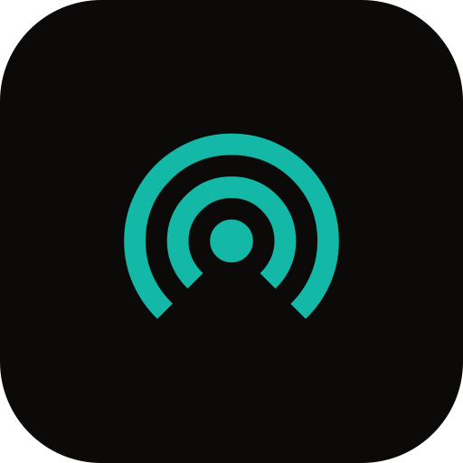

<p align="center">
  
</p>

<h1 align="center">Shizzi</h1>

<p align="center">
  Wi-Fi, USB, and Ethernet tethering over a Shizuku-privileged test network.
</p>

Creates a test TUN interface, sets it as the preferred tethering upstream, and
forwards hotspot traffic through a Go datapath. Supports IPv4 and IPv6.

## Requirements

- Android 11 (API 30+), 64-bit or 32-bit ARM (arm64-v8a or armeabi-v7a)
- [Shizuku](https://shizuku.rikka.app/) 13.6.0+, **or** this phone's own Wireless
  debugging paired once with Shizzi (see [Without Shizuku](#without-shizuku))

Android 13 and up work outright. On Android 11 and 12 it depends on the device's
tethering module; the app checks on first launch and offers to install the
module it needs. That module is 64-bit only, so a 32-bit device needs Android
13. See [compatibility](docs/android-compatibility.md).

## Install

Download the APK from the
[latest release](https://github.com/carlelieser/shizzi/releases/latest).

## Features

- 🚀 **Unlimited hotspot.** Sharing draws on your regular data instead of your
  hotspot allowance.
- 🛡️ **VPN compatible.** Stay private on every connected device.
- ⚙️ **Uses your existing hotspot.** No extra configuration required.
- 🔌 **Wired tethering.** Share over a USB cable to a computer, or over a USB-C
  Ethernet adapter, alongside or instead of the hotspot. Pick it under
  Settings → Tethering → Wired tethering; turn off Wi-Fi hotspot there to share
  over the cable only. See [Ethernet tethering](docs/android-compatibility.md#ethernet-tethering)
  for what an adapter needs.
- 🙌 **No root.** Shizuku is all it needs, or pair Shizzi with the phone's own
  Wireless debugging and skip Shizuku.
- 🎛️ **One tap away.** A quick settings tile starts and stops sharing from the
  notification shade.
- 🤖 **Automatable.** Start and stop from Tasker or MacroDroid. See
  [automation](docs/automation.md).

## Without Shizuku

Shizzi can start its helper through the phone's own Wireless debugging. No PC
and no Shizuku are needed after a one-time pairing. Shizuku is still used
whenever it is running.

1. Open Settings → Permissions → Wireless debugging (adb) in Shizzi.
2. Turn on Wireless debugging in Developer options and choose Pair device with
   pairing code.
3. Tap Pair from a notification and type the code in the notification, or enter
   the port and code in the app. Settings can stay open; the code changes if
   that dialog closes.

The first start after each boot needs Wi-Fi so Wireless debugging is available.
With Keep a TCP port on (the default, port 5555), the helper can restart later
without Wi-Fi. You can pick another port (1024-65535) or a random one each time. While the port is open, any device on the same network can reach
it (adbd cannot bind to localhost only), and it is cleared on reboot. Turn the option off if that is a concern.

The pairing flow is based on the idea of
[vincentng295/Magic_V2Ray](https://github.com/vincentng295/magic_v2ray), a
system-level transparent proxy routing engine using Xray-core.

## Troubleshooting

**Shizuku stops when the hotspot or wired tethering turns on.** If you start
Shizuku with Wireless Debugging, a network change can turn Wireless Debugging
off and take Shizuku with it. Sharing resumes once Shizuku is started again.
Starting Shizuku with root, or over adb in TCP mode, avoids the problem.

**Connected devices bypass the VPN, or sharing won't start with VPN set to
Always.**
Shizzi only sees a VPN that covers every app. If your VPN app has per-app proxy
or split tunneling turned on (v2rayNG and AmneziaVPN, for example), Shizzi
cannot detect the VPN. Turn that setting off in the VPN app.

## Build

Needs the Android SDK with NDK, Go, and gomobile:

```
go install golang.org/x/mobile/cmd/gomobile@latest && gomobile init
./gradlew assembleDebug
```
